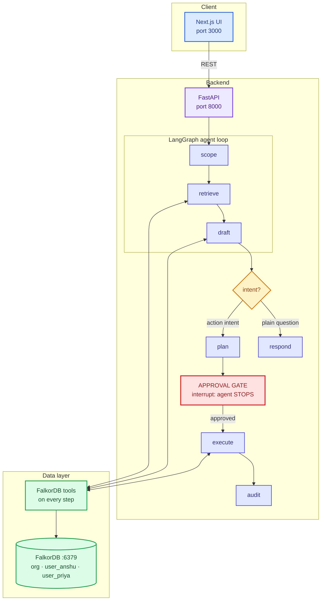

# Recall - The Company That Remembers

The company brain that shows its work.

> What is real: the FalkorDB instance, the Groq calls, and the kill-switch
> behavior are all real and live. Meridian Pay is fictional; every person,
> incident, message, and decision in it is seeded test data.

An institutional-memory agent for a fictional fintech, Meridian Pay. It
connects incidents, ADRs, commits, services, teams, and people in FalkorDB;
answers with traced graph paths; predicts blast radius; remembers and
forgets correctly per employee; and pauses for human approval before acting.

This is one entry across all three tracks:

- **Track 1 - Agents That Act on Connected Data:** multi-hop blast-radius
  reasoning drafts a migration plan, the loop pauses at an approval gate,
  every decision lands in an audit trail, and the agent selects its FalkorDB
  tools through an MCP client.
- **Track 2 - Agent Memory and Coordination:** episodic-to-semantic memory,
  per-employee isolated graphs, supersession history, forgetting with
  erasure receipts and negative-recall proof, plus procedural memory
  (seeded runbooks; "how do we" questions return steps with sources).
- **Track 3 - Company Brain:** ownership, expertise ranking, decision
  provenance, and every answer carrying traced paths plus sources.

Demo video: https://youtu.be/F9H5nxtCiow

## Problem

Company knowledge dies in chat threads and docs. When an incident fires,
nobody can answer why a decision was made, what breaks if a service
changes, who knows the system best, or what the team believed last month.
Chatbots over document dumps guess at these answers. This project keeps
the causal history in a graph and reasons over it, so every answer shows
its work: the path, the evidence, and the approver.

## Setup

Prerequisites: Docker, Python 3.12 or newer, Node 18 or newer, and a free
Groq API key in the environment (never in the repo).

```bash
# 1. Start FalkorDB (exact pinned image, the only infrastructure needed)
docker run -d -p 6379:6379 falkordb/falkordb:6.0.1

# 2. Backend (from the repo root; a venv is recommended)
pip install -r requirements.txt
export GROQ_API_KEY="your-key-here"

# 3. Load the synthetic org (idempotent, safe to run twice)
PYTHONPATH=. python scripts/seed.py

# 4. Serve the API on http://localhost:8000
PYTHONPATH=. python -m uvicorn app.main:app --port 8000

# 5. Frontend on http://localhost:3000 (second terminal)
cd web && npm install && npm run dev

# 6. Benchmark (needs GROQ_API_KEY; use --mock for offline plumbing checks)
PYTHONPATH=. python eval/run.py
```

No keys ship in the repo. `.env.example` holds placeholders only.

## Architecture



The agent classifies scope (org-only, user-only, or both), runs
parameterized hero queries against one graph each, and drafts answers only
from returned evidence, with every claim citing a `source_ref`. Anything
that looks like an irreversible action becomes a proposed `Action` node;
the loop pauses until a human approves or rejects, then writes
`APPROVED_BY` or `REJECTED_BY` edges. Tools run behind an MCP client
(same logic, stdio transport), and how-do questions route to
recall_procedure. Memory writes go to the asker's own
graph. FalkorDB never sees a cross-graph query.

## Graph data model

Two graph kinds. `org` holds company knowledge. Each `user_<id>` graph
holds one employee's memory. The app layer resolves scope.

Node labels (every node carries `source_type` plus `source_ref`):

| Label            | Key properties                                                                      |
| ---------------- | ----------------------------------------------------------------------------------- |
| `Person`         | `id`, `name`, `team`, `at`                                                          |
| `Team`           | `id`, `name`, `at`                                                                  |
| `Service`        | `id`, `name`, `owner_team`, `at`                                                    |
| `Incident`       | `id`, `title`, `at`, `severity`                                                     |
| `ADR`            | `id`, `title`, `at`                                                                 |
| `Commit`         | `id`, `message`, `sha`, `at`                                                        |
| `PR`             | `id`, `title`, `at`                                                                 |
| `Message`        | `id`, `text`, `at`, `author`                                                        |
| `Procedure`      | `id`, `title`, `steps`, `source_type`, `source_ref`                                 |
| `Topic`          | `name`                                                                              |
| `MemoryFact`     | `id`, `text`, `salience`, `at`, `valid_until` (null means current), `superseded_by` |
| `Action`         | `id`, `goal`, `plan` (JSON), `status` (proposed, approved, rejected, executed), `at`, `executed_at` |
| `ErasureReceipt` | `id` (for example `ERASURE-9f3c2a`), `fact_ref`, `text`, `at`, `scope`              |

Edge types and locked directions:

| Edge                          | Direction                                          | Meaning             |
| ----------------------------- | -------------------------------------------------- | ------------------- |
| `DEPENDS_ON`                  | `(consumer)-[:DEPENDS_ON]->(provider)`             | service dependency  |
| `OWNS`                        | `(Team)-[:OWNS]->(Service)`                        | ownership           |
| `WORKS_ON`                    | `(Person)-[:WORKS_ON]->(Service)`                  | staffing            |
| `AUTHORED`                    | `(Person)-[:AUTHORED]->(ADR)`                      | authorship          |
| `RESOLVED_BY`                 | `(Incident)-[:RESOLVED_BY]->(Person)`              | who fixed it        |
| `CAUSED_BY`                   | `(Incident)-[:CAUSED_BY]->(PR)`                    | causality           |
| `DECIDED_IN`                  | `(PR)-[:DECIDED_IN]->(ADR)`                        | decision provenance |
| `CITED_IN`                    | `(ADR)-[:CITED_IN]->(Commit)`                      | evidence link       |
| `MENTIONS`                    | `(anything)-[:MENTIONS]->(Topic)`                  | topic tagging       |
| `REMEMBERS`                   | `(Person)-[:REMEMBERS]->(MemoryFact)`              | per-user memory     |
| `SUPERSEDES`                  | `(new MemoryFact)-[:SUPERSEDES]->(old MemoryFact)` | versioning          |
| `APPROVED_BY` / `REJECTED_BY` | `(Action)-[:APPROVED_BY]->(Person)`                | audit trail         |

Memory has three states: current (`valid_until IS NULL`, the only state
ever answered from), superseded (kept as history, never current), erased
(node deleted, only the receipt remains, and the agent answers "I no
longer have that fact in active memory. I can show you the erasure
receipt.").

The demo org: Ledger (provider) <- Payments <- Retry <- Notifications via
`DEPENDS_ON`; Settlement is isolated contrast. Payments-team owns Ledger
and Payments; Growth-team owns the rest. Anshu authored ADR-14, Priya
resolved INC-231, Ravi works on Notifications. INC-231 `CAUSED_BY` PM-231
`DECIDED_IN` ADR-14 `CITED_IN` commit `7f3c`.

## Hero Cypher

The five parameterized queries the product depends on (FalkorDB 6.0.1
dialect; run them with `scripts/hero_queries.py`):

1. Why-path (incident to code, must include `CITED_IN`):

```cypher
MATCH p = (i:Incident {id: $incident_id})-[:CAUSED_BY|RESOLVED_BY|DECIDED_IN|CITED_IN*1..4]-(n)
RETURN [x IN nodes(p) | labels(x)[0] + ': ' + coalesce(x.title, x.name, x.message, x.id)] AS trace,
       [r IN relationships(p) | type(r)] AS edges,
       length(p) AS hops
ORDER BY hops DESC LIMIT 5
```

2. Blast radius (dependents via incoming `DEPENDS_ON`; the `CALL UNION`
   shape is required because FalkorDB cannot `UNWIND` concatenated lists):

```cypher
MATCH (s:Service {name: $service})
CALL {
  WITH s
  MATCH p = (s)<-[:DEPENDS_ON*1..3]-(d:Service)
  RETURN d AS svc, length(p) AS hops
  UNION
  WITH s
  MATCH p = (s)-[:AFFECTS*1..3]->(a:Service)
  RETURN a AS svc, length(p) AS hops
}
MATCH (t:Team)-[:OWNS]->(svc)
RETURN svc.name AS affected, t.name AS owner_team, min(hops) AS hops
ORDER BY affected
```

3. Who-knows (weighted expertise; `(p:Person)` binds before any
   `OPTIONAL MATCH`; weights works_on 1.0, authored 1.5, resolved 2.0):

```cypher
MATCH (t:Topic {name: $topic})
MATCH (p:Person)
OPTIONAL MATCH (p)-[r1:WORKS_ON]->(x1)-[:MENTIONS]->(t)
OPTIONAL MATCH (p)-[r2:AUTHORED]->(x2)-[:MENTIONS]->(t)
OPTIONAL MATCH (i:Incident)-[r3:RESOLVED_BY]->(p), (i)-[:MENTIONS]->(t)
WITH p, count(DISTINCT r1) AS worked, count(DISTINCT r2) AS authored,
     count(DISTINCT r3) AS resolved,
     max(coalesce(x1.at, x2.at, i.at)) AS latest
WITH p, worked, authored, resolved, latest,
     (worked * 1.0 + authored * 1.5 + resolved * 2.0) AS score
WHERE score > 0
RETURN p.name AS person, score, worked AS worked_on,
       authored AS authored_docs, resolved AS resolved_incidents,
       latest AS latest_activity
ORDER BY score DESC, latest DESC LIMIT 5
```

4. Bus factor (defined on staffing, since ownership here is Team-level):

```cypher
MATCH (p:Person)-[:WORKS_ON]->(s:Service)
WITH s, collect(p.name) AS staff WHERE size(staff) = 1
RETURN s.name AS service, staff[0] AS sole_worker
ORDER BY service
```

5. Per-tenant memory recall (current facts only, one user graph):

```cypher
MATCH (u:Person {id: $user})-[:REMEMBERS]->(f:MemoryFact)
WHERE f.valid_until IS NULL
RETURN f.text AS fact, f.salience AS s, f.at AS at
ORDER BY s DESC, at DESC LIMIT 10
```

## What breaks without FalkorDB

Everything. Remove the graph and the agent cannot answer a single
question: every tool call fails, every endpoint degrades to the same
honest message on outage (bad input still returns specific errors),
and the UI shows it. The demo proves this live with the
kill-switch (topbar demo control, backed by admin endpoints): disconnect,
ask the same question, get the fallback, reconnect, get the traced answer
back.

The exact fallback message:

```json
{
  "error": "I can't answer this. The relationships required for the answer don't exist in the fallback."
}
```

## Eval results

30 questions, 5 categories, one-command runner (`eval/run.py`, also
`POST /eval/run`). Flat RAG (fastembed chunks of the same corpus, top-5,
same Groq model for drafting) versus pure Cypher graph traversal. No vector
step exists in the product path; fastembed lives only in eval/ powering
the flat-RAG baseline arm.
Structured scoring per question: did the answer surface the required
evidence. An LLM judge notes narration quality only.

Final live run (Groq `openai/gpt-oss-120b` for both arms, n=30):

| Category     | n      | Graph      | Flat RAG   |
| ------------ | ------ | ---------- | ---------- |
| Causal why   | 10     | 8.667      | 8.417      |
| Blast radius | 6      | 5.0        | 3.334      |
| Ownership    | 6      | 5.0        | 4.5        |
| Temporal     | 4      | 4.0        | 2.0        |
| Memory       | 4      | 2.0        | 1.0        |
| **Total**    | **30** | **24.667** | **19.251** |

Methodology, disclosed fully: same corpus source, same LLM, same
questions, same expected-evidence definitions for both arms. The RAG index
is a static snapshot taken before the eval mutations (supersede, forget),
modeling a periodically reindexed baseline; the graph arm reads live data.
The scorer folds Unicode dashes and spaces to ASCII before matching,
applied equally to both arms (the LLM's typography, not tuning). The
question set was frozen before the final run. Remaining zeros are
reported, not hidden: strict-phrase misses both arms accept (blast-04),
and one known product limitation, the blast tool does not return the
queried service's own owner, so the ownership question about Ledger's team
scores graph 0.0.

Concurrency probe (local stack, template drafting, no Groq key in backend
env): 50 concurrent mixed ask, remember, and blast-radius requests against
`localhost:8000` completed 50/50 with p50 0.557s, p95 0.664s, zero duplicate
fact ids across 10 concurrent remembers, and all 10 probe facts persisted
under an isolated loadprobe user. Reproduce with
`.venv/bin/python scripts/load_probe.py`.

## Data honesty

Every node in every graph is synthetic (`source_type: synthetic`) per the
seed in `scripts/seed.py`. No real company data, no real user data, no
scraped content. Eval fixtures live in the isolated `user_evalprobe`
graph and never touch demo users. No API keys or personal data are
committed anywhere; `GROQ_API_KEY` comes from the environment only.

## API overview

Base `http://localhost:8000`. `POST /ask` runs the agent loop.
`GET /blast-radius`, `GET /who-knows`, memory endpoints
(`remember`, `supersede`, `forget`, `memory`, `memory/history`), action
endpoints (`propose`, `approve`, `reject`, `execute`, `audit`), `GET /health`,
`POST /eval/run`, and the demo-only `/admin/disconnect` and
`/admin/reconnect`.

## AI-assistant use disclosure

Built with OpenCode, an agentic coding assistant, guided by Muse. Every
line was written fresh October 15-18, 2026, in this repo's progressive
commit history, which reads as the build log. The human author reviewed
each phase, ran the live benchmark, and owns every query and decision in
this codebase.
